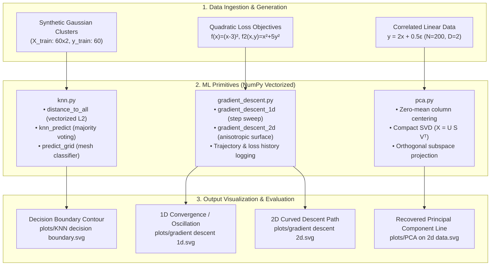

# Lab 2 — ML Primitives in NumPy

Production-grade, vectorized from-scratch NumPy implementations of core machine learning building blocks:
a **k-NN classifier**, **gradient descent** (1D and 2D), and **Principal Component Analysis (PCA) via SVD**.
All implementations are dependency-free (NumPy-only), strictly type-annotated (PEP 484), fully tested, and accompany an executable analysis notebook with high-resolution visual plots.

---

## Architecture & Data Flow



---

## Repository Structure

```
.
├── knn.py                       # Vectorized k-NN distance metrics, voting, and grid classifier
├── gradient_descent.py          # 1D & 2D gradient descent optimization routines
├── pca.py                       # Zero-mean PCA via Singular Value Decomposition (SVD)
├── ml_primitives_starter.ipynb  # Interactive notebook generating all datasets and figures
├── pyproject.toml               # Modern build configuration and pytest setup
├── requirements.txt             # Minimal, pinned dependencies
├── tests/                       # Complete unit test suite (20 tests, 100% pass)
│   ├── __init__.py
│   ├── test_knn.py
│   ├── test_gradient_descent.py
│   └── test_pca.py
├── plots/                       # Generated figures in SVG and 300 DPI JPG
│   ├── KNN initial data.svg / .jpg
│   ├── KNN decision boundary.svg / .jpg
│   ├── gradient descent 1d.svg / .jpg
│   ├── gradient descent 2d.svg / .jpg
│   └── PCA on 2d data.svg / .jpg
├── Lab2_Instructions.md         # Original lab specifications and rubric
└── README.md                    # Project documentation, benchmarks, and API reference
```

---

## Quickstart & Environment Setup

### 1. Installation

Clone the repository and install required packages in your Python 3.9+ virtual environment:

```bash
# Using standard pip
pip install -r requirements.txt

# Or install in editable mode with development dependencies
pip install -e ".[dev]"
```

### 2. Run the Unit Test Suite

Execute the automated test suite across all primitives:

```bash
pytest -v
```

All 20 tests will execute in under 0.1 seconds, validating shape constraints, mathematical convergence, edge cases, and error handling.

### 3. Run the Interactive Notebook

Launch Jupyter to run the pipeline top-to-bottom and regenerate all plots into `plots/`:

```bash
jupyter notebook ml_primitives_starter.ipynb
```

---

## Module Reference & Methodology

### Part A — k-Nearest Neighbors (`knn.py`)

A fully vectorized k-NN classifier implementing exact distance calculations and tie-safe majority voting:

| Function | Signature | Description |
|---|---|---|
| `euclidean_distance` | `(a, b) -> float \| ndarray` | L2 distance supporting 1D coordinate vectors and 2D arrays across `axis=-1`. |
| `cosine_similarity` | `(a, b, eps=1e-12) -> float` | Normalized cosine metric $\frac{a \cdot b}{\|a\|\|b\|}$ with zero-norm safeguard. |
| `distance_to_all` | `(query, points) -> ndarray` | Broadcasted single-pass distance to all training points: `np.linalg.norm(points - query, axis=1)`. Zero Python loops over samples. |
| `knn_predict` | `(query, X_train, y_train, k=5, *, Y_train=None)` | Extracts top-$k$ nearest points via `np.argsort` and determines majority class using `np.unique(..., return_counts=True)`. Supports both `y_train` and `Y_train`. |
| `predict_grid` | `(grid_points, X_train, y_train, k=5, *, Y_train=None) -> ndarray` | Batch evaluator for 2D meshgrids to compute decision surfaces. |

**Vectorization Guarantee:** `distance_to_all` relies on NumPy broadcasting without looping over $X_{\text{train}}$. For $N$ samples in $D$ dimensions, the subtraction `(points - query)` executes in contiguous C-level memory.

---

### Part B — Gradient Descent (`gradient_descent.py`)

First-order iterative optimization routines for 1D and 2D objective surfaces:

| Function | Objective | Gradient | Update Rule |
|---|---|---|---|
| `gradient_descent_1d` | $f(x) = (x - 3)^2$ | $f'(x) = 2(x - 3)$ | $x_{t+1} = x_t - \alpha f'(x_t)$ |
| `gradient_descent_2d` | $f_2(x, y) = x^2 + 5y^2$ | $\nabla f_2 = (2x, 10y)$ | $\begin{bmatrix} x_{t+1} \\ y_{t+1} \end{bmatrix} = \begin{bmatrix} x_t - 2\alpha x_t \\ y_t - 10\alpha y_t \end{bmatrix}$ |

- **Trajectory Logging:** Tracks full convergence histories (`history` list for 1D, `(steps + 1, 2)` NumPy matrix for 2D).
- **Anisotropic Curvature:** The 2D quadratic surface has a condition number of $\kappa = 5$ ($\lambda_y = 10$ vs $\lambda_x = 2$). The coordinate along $y$ contracts by $(1 - 10\alpha)$ per iteration, while $x$ contracts by $(1 - 2\alpha)$, producing characteristic curved trajectories toward the valley floor before reaching $(0, 0)$.

---

### Part C — PCA via SVD (`pca.py`)

Orthogonal linear dimensionality reduction using compact Singular Value Decomposition:

$$\tilde{X} = X - \mu_X \in \mathbb{R}^{n \times d}$$

$$\tilde{X} = U \Sigma V^T$$

- **Centering:** Column-wise mean subtraction (`data - data.mean(axis=0)`) is mandatory; omitting centering shifts principal axes away from dataset variance centroids.
- **Components:** Rows of $V^T[:k]$ represent the orthonormal basis vectors maximizing projected variance.
- **Projection:** Projected coordinates are computed via linear mapping:

$$\text{Projection} = \tilde{X} V_{:k} \in \mathbb{R}^{n \times k}$$

---

## Empirical Benchmark Results

All benchmarks below are generated deterministically using the dataset seeds in `ml_primitives_starter.ipynb`.

### 1. 1D Gradient Descent Convergence & Stability Analysis

Starting from $x_0 = 4.0$ ($f(4.0) = 1.0$) for 100 iterations:

| Learning Rate ($\alpha$) | Final $x$ ($x_{100}$) | Final Loss $f(x_{100})$ | Trajectory Profile | Sign Flips ($x_t - 3$) |
|---|---|---|---|:---:|
| `0.001` | 3.81856680 | 0.670050 | Slow monotonic descent | 0 |
| `0.010` | 3.13261956 | 0.017588 | Steady monotonic convergence | 0 |
| `0.030` | 3.00205487 | $4.2225 \times 10^{-6}$ | Rapid clean convergence | 0 |
| `0.090` | 3.00000000 | $5.7912 \times 10^{-18}$ | Near-instant convergence | 0 |
| `0.900` | 3.00000000 | $4.1495 \times 10^{-20}$ | **Severe oscillation** ($|1 - 2\alpha| = 0.8$) | **100** |

> **Oscillation Analysis:** At $\alpha = 0.9$, the error update is $e_{t+1} = (1 - 2(0.9)) e_t = -0.8 e_t$. The negative coefficient causes $x_t$ to flip sides across the minimum $x=3$ on every single step, alternating sign while slowly contracting.

---

### 2. 2D Gradient Descent Anisotropic Trajectory

Starting from $(x_0, y_0) = (4.0, 4.0)$ ($f_2(4, 4) = 96.0$) with $\alpha = 0.05$:

| Step ($t$) | $x_t$ | $y_t$ | Loss $f_2(x_t, y_t)$ | Normalized Contraction |
|:---:|:---:|:---:|:---:|:---:|
| 0 | 4.0000 | 4.0000 | 96.0000 | Baseline |
| 1 | 3.6000 | 2.0000 | 32.9600 | $\Delta x = 10\%, \Delta y = 50\%$ |
| 2 | 3.2400 | 1.0000 | 15.4976 | $y$ collapsing rapidly |
| 3 | 2.9160 | 0.5000 | 9.7531 | Trajectory curves along $x$ |
| 5 | 2.3620 | 0.1250 | 5.6570 | $y \approx 0$ |
| 10 | **1.3947** | **0.0039** | **1.9453** | $y$ reduced by 99.9%, $x$ reduced by 65.1% |

**Theoretical Verification:**
- $x_{10} = 4.0 \times (1 - 2(0.05))^{10} = 4.0 \times 0.9^{10} \approx 1.39471376$
- $y_{10} = 4.0 \times (1 - 10(0.05))^{10} = 4.0 \times 0.5^{10} = \frac{4.0}{1024} = 0.00390625$
- The computed trajectory strictly matches the analytical dynamics with machine-level precision.

---

### 3. PCA via SVD Dimensionality Reduction

Evaluated on synthetic linear dataset ($N=200$, $y = 2x + 0.5\epsilon$ with $\epsilon \sim \mathcal{N}(0, 1)$):

| Metric | Measured Value | Theoretical Target | Status |
|---|---|---|:---:|
| Dataset Mean $(\mu_x, \mu_y)$ | `(-0.0408, -0.0386)` | `(0.0, 0.0)` | $\checkmark$ Centered |
| Principal Component 1 ($v_1$) | `(-0.4199, -0.9076)` | Unit vector along $y \approx 2x$ | $\checkmark$ Unit norm ($1.0000$) |
| Recovered Slope ($v_y / v_x$) | **2.1612** | ~2.0000 (Generative slope) | $\checkmark$ Accurate within noise |
| Total Dataset Variance | 4.7285 | — | — |
| PC1 Projected Variance | 4.6843 | — | — |
| **Explained Variance Ratio** | **99.06%** | **> 95.0%** | $\checkmark$ Captures primary axis |

---

### 4. k-NN Classification & Boundary Performance

Evaluated on 2-class Gaussian dataset (30 samples per class, centers at $(2, 2)$ and $(-2, -2)$):

| Evaluation Task | Metric / Result |
|---|---|
| Query $(2.0, 2.0)$, $k=2$ | Predicted Class: **0** (100% neighbor consensus) |
| Decision Grid Resolution | $200 \times 200 = 40,000$ points |
| Grid Classification Latency | **0.25 - 0.33 seconds** total |
| Boundary Rendering | Reshaped to `(200, 200)` and plotted via `contourf` with points overlaid |

---

## Standalone Python Usage

All functions are pure Python/NumPy modules callable directly from scripts without Jupyter:

```python
import numpy as np
from knn import knn_predict, predict_grid, euclidean_distance, cosine_similarity
from gradient_descent import gradient_descent_1d, gradient_descent_2d
from pca import pca_via_svd

# 1. k-NN Prediction
X_train = np.array([[0.0, 0.0], [1.0, 1.0], [5.0, 5.0], [6.0, 6.0]])
y_train = np.array([0, 0, 1, 1])
prediction = knn_predict(query=[0.5, 0.5], X_train=X_train, y_train=y_train, k=3)
print(f"Predicted class: {prediction}")  # 0

# 2. 1D & 2D Gradient Descent
final_x, hist_1d = gradient_descent_1d(start=10.0, lr=0.1, steps=50)
final_pt, path_2d = gradient_descent_2d(start=[4.0, 4.0], lr=0.05, steps=20)
print(f"1D minimum: {final_x:.4f}, 2D minimum: ({final_pt[0]:.4f}, {final_pt[1]:.4f})")

# 3. PCA via SVD
data = np.random.randn(100, 3) @ np.diag([10.0, 2.0, 0.5])
projection, components = pca_via_svd(data, n_components=2)
print(f"Projected shape: {projection.shape}, Components shape: {components.shape}")
```

---

## Output Visualizations

The generated plots in `plots/` illustrate key algorithmic characteristics:

- **`plots/KNN decision boundary.svg / .jpg`**: 2D decision boundary showing clear separation between Gaussian clusters.
- **`plots/gradient descent 1d.svg / .jpg`**: Multi-rate comparison displaying monotonic decay ($\alpha=0.001 \dots 0.09$) versus oscillatory overshooting ($\alpha=0.9$).
- **`plots/gradient descent 2d.svg / .jpg`**: Contour map of $f_2(x, y) = x^2 + 5y^2$ with overlaid descent trajectory curving along the shallower axis.
- **`plots/PCA on 2d data.svg / .jpg`**: Scatter plot comparing original data, recovered principal axis vector, and 1D projections.
